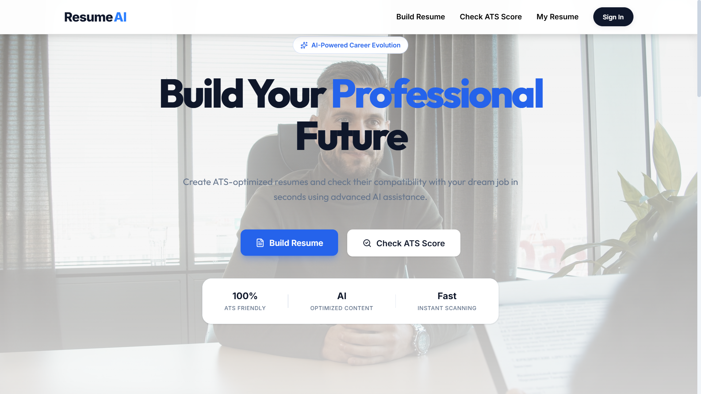

<div align="center">

  ### *Next-Generation AI-Powered Resume Builder & ATS Analyzer*
<b>Empowering job seekers to land top-tier interviews with AI-tailored resumes and instant ATS compatibility scoring.</b>

<br>


  <br />

  

</div>

---

## 📌 Overview

**ResumeAI** is an end-to-end, full-stack web application designed to bridge the gap between job seekers and Applicant Tracking Systems (ATS). Powered by **Google Gemini AI**, ResumeAI analyzes resumes against target job descriptions, identifies missing keywords, calculates ATS compatibility scores, and suggests real-time bullet-point enhancements.

Whether you're crafting a new resume from scratch or optimizing an existing PDF, ResumeAI delivers pixel-perfect, recruiter-approved templates engineered for high readability and maximum ATS passing rates.

---

## ✨ Key Features

| Feature | Description |
| :--- | :--- |
| **🤖 Gemini AI Optimization** | Generates high-impact action bullets, polishes professional summaries, and rewrites weak phrases instantly. |
| **🎯 Smart ATS Compatibility Matcher** | Upload job descriptions to receive a 0–100% compatibility score with detailed missing keyword alerts. |
| **🎨 Dynamic Template Engine** | Switch seamlessly between battle-tested, ATS-friendly resume templates with live visual preview. |
| **📄 High-Precision PDF Export** | Render vector-quality downloadable PDFs built using `@react-pdf/renderer` & parse with `pdfjs-dist`. |
| **🔐 Enterprise-Grade Security** | Secure auth via JWT cookies, password hashing with `bcryptjs`, and strict input validation with `zod`. |
| **⚡ Modern Animated UX** | Fluid UI experience with dynamic micro-interactions powered by `framer-motion` & `gsap`. |
| **☁️ Cloud Document Sync** | Store and retrieve saved resumes securely via MongoDB Atlas & Cloudinary integration. |

---

## 🛠️ Tech Stack

### **Frontend**
* **Framework:** React, TypeScript, Vite
* **Styling & UI:** Tailwind CSS, Lucide Icons, Lottie Animations
* **State & Motion:** Framer Motion, React Router
* **PDF Processing:** `@react-pdf/renderer`, `pdfjs-dist`
* **Notifications:** React Hot Toast

### **Backend**
* **Runtime:** Node.js, Express.js (ESM / TypeScript)
* **Database & ORM:** MongoDB Atlas, Mongoose ORM
* **Artificial Intelligence:** Gemini API
* **Security & Middleware:** JWT, BcryptJS, Helmet, Express Rate Limit, Express Mongo Sanitize, Zod
* **Storage & Utilities:** Cloudinary API, Winston Logger, Morgan
* **Testing & Quality:** Vitest, Coverage, ESLint


---

## 🚀 Getting Started

Follow these instructions to get **ResumeAI** running locally.

### 📋 Prerequisites
* **Node.js**
* **npm**
* **MongoDB**
* **Google Gemini API**

---

### 1️⃣ Installation & Setup

Clone the repository and install dependencies for both client and server:

```bash
# Clone the repository
git clone https://github.com/Milind-Yadav07/ResumeAI.git
cd ResumeAI

# Install Frontend dependencies
npm install

# Install Backend dependencies
cd server
npm install
cd ..
```

---

### 2️⃣ Environment Configuration

#### Client (`/.env`):
Create a `.env` file in the root directory:
```env
VITE_API_BASE_URL=http://localhost:5000/api/v1
```

#### Server (`/server/.env`):
Create a `.env` file inside the `server/` directory:
```env
CLIENT_URL=http://localhost:5173
MONGO_URI=mongodb://localhost:MongoDB_Connection_String
GEMINI_API_KEY=your_google_gemini_api_key
JWT_SECRET=your_super_secret_jwt_key
CLOUDINARY_CLOUD_NAME=your_cloudinary_cloud_name
CLOUDINARY_API_KEY=your_cloudinary_api_key
CLOUDINARY_API_SECRET=your_cloudinary_api_secret
```

---

### 3️⃣ Running the Application

#### Start Backend Server:
```bash
cd server
npm run dev
```

#### Start Frontend (in a separate terminal):
```bash
npm run dev
```

Open your browser and navigate to **`http://localhost:5173`** to access **ResumeAI**.

<br>


## 🤝 Contributing

Contributions are welcome! Please feel free to open issues or submit pull requests.

<br>

<div align="center">
  <p>Designed & Developed with ❤️ by <b>Milind Yadav</b></p>
  <p>
    <a href="https://linkedin.com/in/milind-yadav-a89157326">LinkedIn</a>
  </p>
  <sub>⭐ If you find this project impressive, please consider giving it a star on GitHub! ⭐</sub>
</div>

